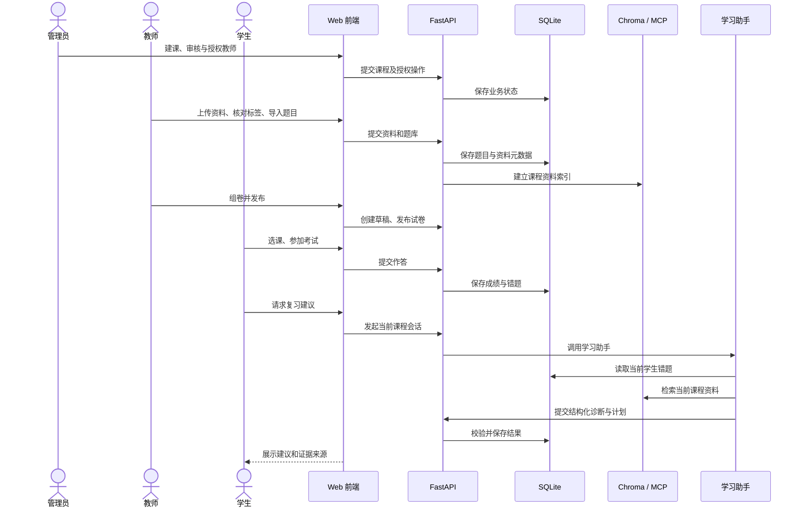

<div align="center">

# CoursePilot

**面向课程测评与个性化复习的 AI 学习平台**

教师管理课程资料、题库和考试；学生完成测评后，学习助手结合错题与课程资料生成有来源的复习建议。


</div>

## 项目概览

CoursePilot 是一个覆盖**管理员、教师、学生**三种角色的教学原型。管理员建课并管理教师授权；教师上传课程资料、审核知识点标签、批量导入题目、组卷发布和批改主观题；学生选课、参加考试、查看成绩与错题，并在 AI 学习助手中追问薄弱点、获取复习计划。

项目由个人使用 **Vibe Coding 辅助开发**：AI 参与需求拆解、实现与调试，业务规则、权限边界、资料引用和评测结论以代码与测试为准。它展示了从产品流程设计到可运行原型、自动化回归和演示材料的完整工作过程。

## 产品体验

推荐按 [3 分钟演示脚本](docs/product_demo.md) 体验完整链路：

1. **教师准备教学内容**：上传讲义，核对系统建议的片段知识点；导入 CSV 题目，从题库创建试卷草稿并发布。
2. **学生完成测评**：参加考试，查看客观题判分结果；简答题由教师批改后形成最终成绩和错题记录。
3. **Agent 辅助复习**：学生基于本课程错题提问，学习助手检索课程资料并输出带证据的复习建议或结构化计划，支持跨轮追问。

独立 Web 前端由 FastAPI 同源提供，启动后访问 `http://127.0.0.1:8000/web/`。当前仓库提供**源码与本地演示流程**，尚未部署可供外部直接操作的在线环境；仓库不包含测试账号、模型密钥、上传文件或数据库。

## 核心能力

### 课程资料：从上传到可追溯检索

- 教师上传 MD、TXT、PDF、DOCX、PPTX 资料；系统解析并切分内容，给片段生成候选知识点标签，再由教师逐段核对。
- 资料按课程建立向量索引。主 Embedding 使用百炼，备用索引可使用本地 Ollama；检索结果保留来源与片段 ID，便于学生查看原文。
- 索引状态与解析失败原因在教师端可见，避免把资料不可用误判为学生没有知识点问题。

### 题库与考试：形成真实测评记录

- 教师按课程批量导入 CSV 题目，前端预览并校验字段，后端继续执行入库校验；题库支持单选、多选、判断、单空填空和简答。
- 从题库选择题目并设置分值，创建试卷草稿；教师预览后发布。学生作答后，客观题和单空填空自动判分，简答题进入教师批改队列。
- 学生可查看最终成绩、逐题反馈和错题。这些真实作答与错题记录构成后续学习建议的依据。

### 学习助手：让建议受事实约束

- 学生助手读取**当前学生、当前课程**的错题和课程资料，生成诊断、复习建议或结构化计划；没有错题或资料时明确说明证据不足。
- 后端校验计划中的题目、知识点和资料引用，避免模型凭空补全证据；追问时按 ID 重新读取原始题目或资料片段。
- 长会话结合摘要、近期消息与证据索引卡；单 Agent 和最小 Multi-Agent 流程可用于对照。

### 评测与可复用执行边界

- 60 条固定业务回归用例覆盖完整计划、零错题、资料缺失、部分结果、MCP 故障和会话越权等情形。
- 可复用的 [Harness](docs/harness_architecture.md) 抽象运行和评测边界，便于记录执行结果及对照不同工作流。
- **评测边界**：固定用例不代表真实 Chroma 检索质量；Gold v1 的 20 条独立事实检查仍待人工批准，v3 尚无可引用的 60 对真实模型对照成绩。历史 v2 结果见[评测说明](docs/review_plan_comparison_v2.md)。

## 系统流程



## 技术架构

| 层次 | 技术 | 职责 |
| --- | --- | --- |
| Web | 原生 JavaScript、HTML、CSS | 三角色界面、题目导入预览、考试与对话交互 |
| API | FastAPI、Pydantic | 鉴权、课程、资料、题库、考试和会话接口 |
| 业务数据 | SQLAlchemy、SQLite | 用户、课程、试卷、作答、错题及 Agent checkpoint |
| 资料检索 | Chroma、MCP、百炼 Embedding、Ollama 备用索引 | 课程范围检索与来源追溯 |
| Agent | LangChain、LangGraph、DeepSeek | 工具调用、诊断、复习计划和跨轮追问 |
| 会话缓存 | Redis | 短期会话缓存 |

```text
web/              独立 Web 前端
app/api/          FastAPI 路由与鉴权入口
app/services/     业务规则、判分、资料索引与复习计划校验
app/repositories/ 数据访问
app/workflows/    学生 Agent 工作流
app/harness/      运行和评测共用的执行边界
evals/            固定数据集与对照评测
tests/            业务及界面回归测试
docs/             演示脚本、架构与评测说明
frontend/         迁移期保留的旧 Streamlit 页面
```

## 本地运行

在 Windows PowerShell 中进入项目根目录。需要 Python 环境与 Redis；运行模型和课程资料检索还需要对应的服务与密钥。若要使用本地备用索引，需启动 Ollama 并准备 `bge-m3`。

```powershell
python -m venv .venv
.\.venv\Scripts\python.exe -m pip install -r requirements.txt
Copy-Item .env.example .env
# 在 .env 中填写独立的 JWT_SECRET_KEY、DeepSeek 与百炼密钥
.\.venv\Scripts\python.exe -m uvicorn app.main:app --reload --port 8000
```

打开 `http://127.0.0.1:8000/web/`；`/health` 用于健康检查，`/docs` 提供接口文档。前端与 API 由同一进程提供，无需启动 Node 或旧版 Streamlit 页面。更完整的三角色操作顺序见[业务流程](docs/role_business_flows.md)。

## 验证

```powershell
.\.venv\Scripts\python.exe -m unittest discover -s tests -q
node web/smoke.test.mjs
.\.venv\Scripts\python.exe -m evals.review_plan_multi_comparison --validate
```

仓库已排除 `.env`、本地数据库、上传文件、向量索引及含学生记录的原始数据文件。复现评测时请使用仓库内可公开的固定样例；不要把本机业务数据直接上传到公开仓库。

更多实现细节见[长会话上下文](docs/long_conversation_context.md)、[MCP 资料检索](docs/mcp_course_material.md)、[双 Embedding 索引](docs/dual_embedding_index.md)和[多知识点资料](docs/multi_topic_materials.md)。

